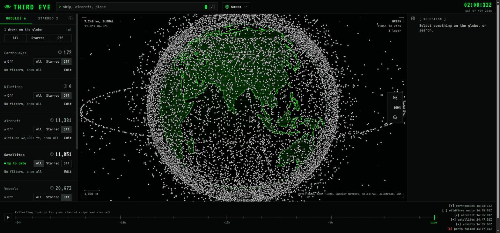
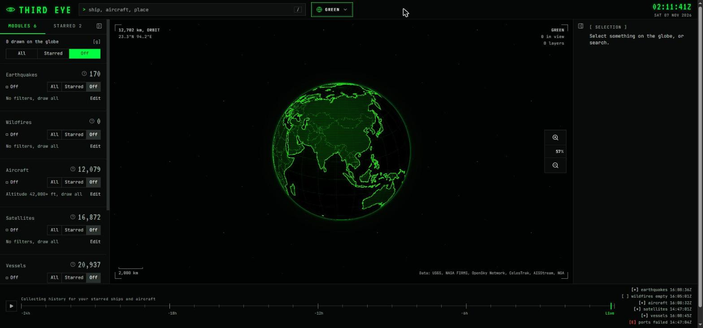
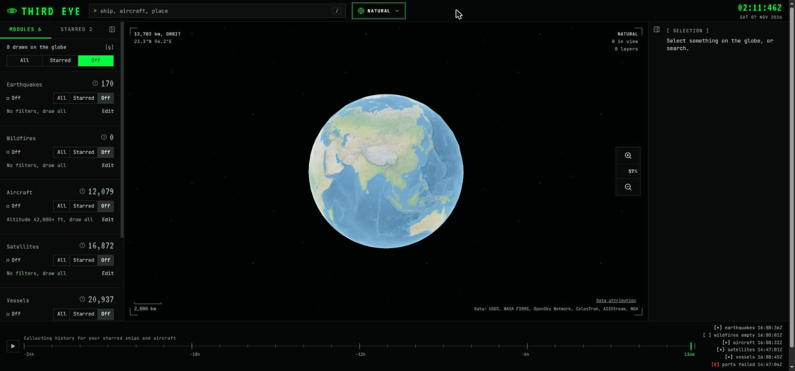
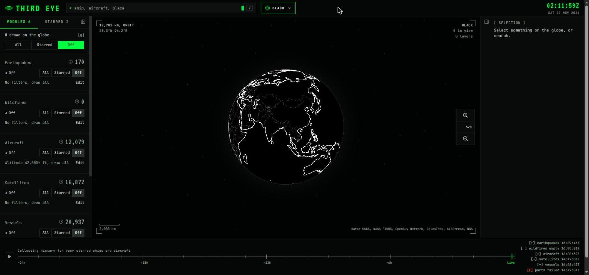
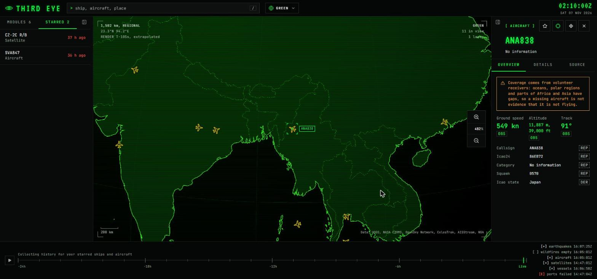
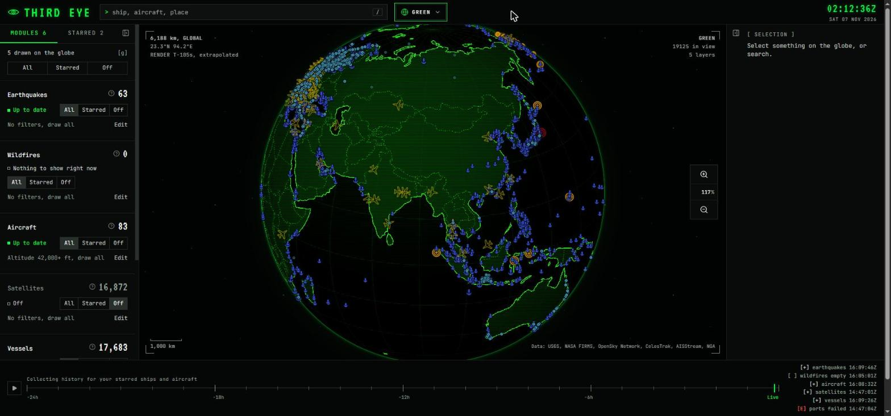
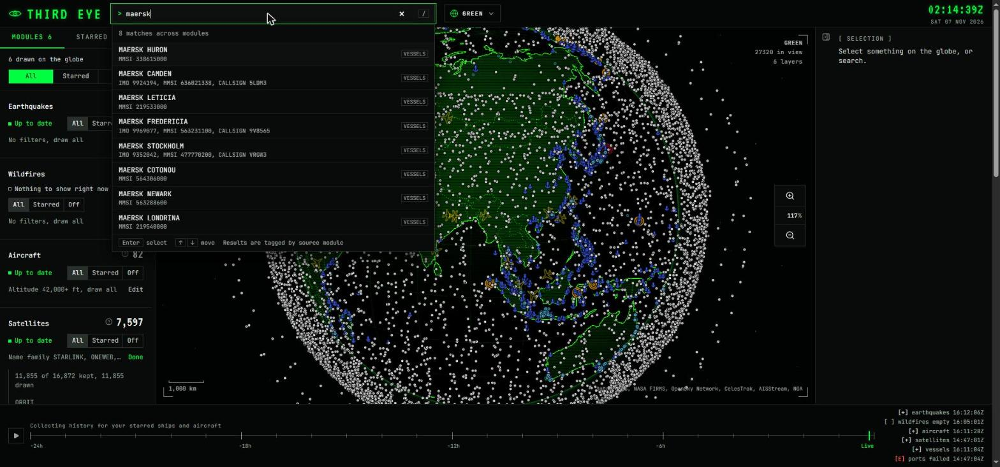
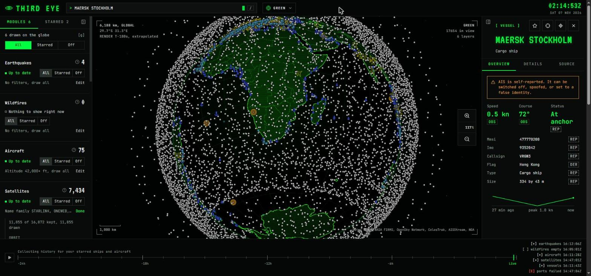
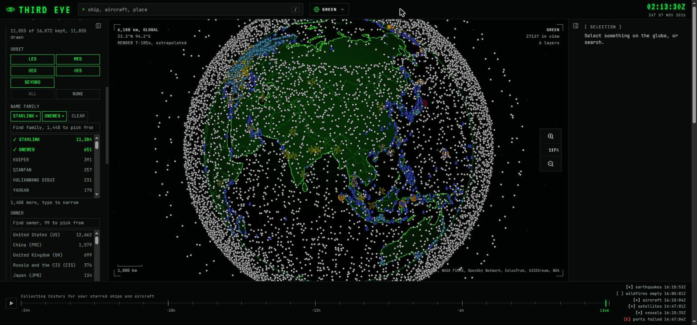
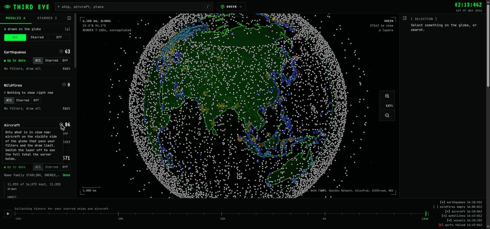

<div align="center">

# Third Eye

**A self-hosted OSINT console. Public data feeds on one 3D globe, with one search across all of them.**

[](https://github.com/SolaimanK05/thirdeye/actions/workflows/ci.yml)
[](LICENSE)




<sub>Every active satellite CelesTrak tracks, drawn at once. Screenshots in this README are live data from a local install.</sub>

</div>

## What it is

Third Eye pulls live public data into your own database and draws it on a CesiumJS globe: aircraft, ships, satellites, earthquakes, wildfires and ports. You run it yourself. There is no account, no hosted service and no telemetry.

Each data source is a **module**. Modules share one globe, one search box and one data model, so a search covers all of them and you can star anything no matter where it came from.

Every panel says where its data came from, how fresh it is and what the source cannot tell you. AIS, for example, is self-reported and can be switched off or spoofed, and the interface says so next to every ship.

## Features

- **Six modules** on one globe, each with its own marker colour and a three-way switch: **All**, **Starred** or **Off**
- **Tens of thousands of moving markers** drawn by a WebGL2 layer (with a canvas fallback), smoothed by interpolating a few seconds behind the data
- **Satellites computed in your browser**: orbital elements are downloaded once a day and propagated with SGP4 every second, so the whole active catalogue (over 15,000 objects) moves with no per-frame network traffic
- **A refine panel on every layer**: ranges, levels, choices and searchable multi-select lists (satellites can be cut by orbit, name family, owner, status, altitude, inclination and launch date)
- **Draw limit and zoom rules**: cap how many markers a layer draws, and layers that are too dense at world scale appear when you zoom in (`SHOW HERE` jumps to where they show)
- **One search box** across every module
- **Selection panel** with key facts, a source tab and, where a module has one, a speed chart
- **Star and follow**: star things to keep them, follow a ship or aircraft and the camera stays on it
- **24-hour replay** with trails for starred ships and aircraft
- **Three globe styles**: Green, Natural and Black
- **Honest counts**: each layer's count says whether it is what you see or the server total

## Screenshots

### Globe styles

The same view with every layer switched off. The style is remembered in your browser.

| Green | Natural | Black |
|:---:|:---:|:---:|
|  |  |  |

### Following an aircraft

Select an aircraft and press `F`: the camera locks on and keeps following as it moves.



### Layers together

Aircraft, ships, earthquakes and ports on the same globe.



### Search and selection

| Search across modules | A selected vessel |
|:---:|:---:|
|  |  |

### Filters and counts

| Satellite filters | The count hint |
|:---:|:---:|
|  |  |

## Modules

| Module | Source | Refresh | Key needed |
|---|---|---|---|
| Earthquakes | [USGS](https://earthquake.usgs.gov/) real-time GeoJSON feed, past day | every 60 s | no |
| Wildfires | [NASA FIRMS](https://firms.modaps.eosdis.nasa.gov/) VIIRS active fires | every 3 h, kept 4 days | `FIRMS_MAP_KEY` |
| Aircraft | [OpenSky Network](https://opensky-network.org/) ADS-B state vectors | about 90 s worldwide, within a daily credit budget | `OPENSKY_CLIENT_ID`, `OPENSKY_CLIENT_SECRET` |
| Vessels | [AISStream](https://aisstream.io/) live AIS, written in batches of a few seconds | streaming | `AISSTREAM_API_KEY` |
| Satellites | [CelesTrak](https://celestrak.org/) GP elements and SATCAT | once a day | no |
| Ports | [NGA](https://msi.nga.mil/Publications/WPI) World Port Index | weekly, imported by you | no |

Each module's panel lists its licence and limitations. Data feeds have their own terms, and the footer credits every source.

## How it works

Three parts: a **worker** that polls the sources, an **API** that serves what the worker stored, and a **web app** that draws it.

<picture>
  <source media="(prefers-color-scheme: dark)" srcset="assets/diagrams/overview-dark.svg">
  
</picture>

The worker is the only part that talks to the outside world. The API serves what is in the database (and keeps your stars), so a source going down never takes the globe down: you keep the last data, and the panel shows how old it is.

Inside the web app, live data goes straight into typed arrays and never passes through React state:

<picture>
  <source media="(prefers-color-scheme: dark)" srcset="assets/diagrams/web-flow-dark.svg">
  
</picture>

- Aircraft and vessels travel as **TEF1 frames**: a compact little-endian binary format of typed columns (slot, position, time, speed, course, altitude, flags, class). One snapshot is fetched, then small deltas follow the server's change notices. Compression comes from HTTP content encoding (gzip or zstd), never inside the frame. The format is described in [`contracts/frames`](contracts/frames/README.md).
- Earthquakes, wildfires and ports are layers of rows fetched over REST and cached with ETags.
- Satellites never arrive as positions. The API serves the orbital elements, and the browser works out where each object is.

## Quick start

You need Node 24, pnpm 12, [uv](https://docs.astral.sh/uv/) (it installs Python 3.14 for you), `make`, and Docker with the [Supabase CLI](https://supabase.com/docs/guides/local-development) for a local Postgres. Developed on Ubuntu 24.04 under WSL2.

**1. Get the code and install**

```bash
git clone https://github.com/SolaimanK05/thirdeye.git
cd thirdeye
pnpm --dir apps/web install
(cd apps/api && uv sync)
```

**2. Start the database** (applies the migrations in `supabase/migrations`)

```bash
supabase start
```

**3. Configure**

```bash
cp apps/api/.env.example apps/api/.env
cp apps/web/.env.example apps/web/.env.local
```

In `apps/api/.env`, list the modules you want. Nothing runs until you do:

```bash
MODULES_ENABLED=["earthquakes", "satellites", "ports", "wildfires", "aircraft", "vessels"]
```

Earthquakes and satellites need no key. For the others, add the keys from the [Modules](#modules) table.

**4. Run** (three terminals)

```bash
make dev-worker   # polls the sources
make dev-api      # http://localhost:8000
make dev-web      # http://localhost:3000
```

Open http://localhost:3000. Layers fill in as the worker's first polls finish; satellites take longest because the catalogue is one large download.

**5. Ports** (optional, once). Download the World Port Index file from [NGA](https://msi.nga.mil/Publications/WPI), then:

```bash
make import-ports FILE=path/to/the-file
```

### Configuration

Every setting is in [`apps/api/.env.example`](apps/api/.env.example), commented line by line. The ones you will touch first:

| Setting | What it does |
|---|---|
| `DATABASE_URL` | Postgres connection (the default matches `supabase start`) |
| `MODULES_ENABLED` | Which modules run |
| `REGION_BBOX` | `[west, south, east, north]` box the regional feeds are limited to |
| `OPENSKY_BBOX`, `AISSTREAM_BBOX` | Per-feed boxes, to keep within your API credits |
| `SATELLITE_GROUP` | CelesTrak group to load (`active` by default) |
| `RETENTION_EVENT_DAYS`, `RETENTION_STARRED_HOURS` | How long events and starred positions are kept |
| `RUN_WORKER` | Run the worker inside the API process instead of as its own |

## Keyboard

| Key | Action |
|---|---|
| `/` | Focus search |
| `S` | Star or unstar the selection |
| `F` | Follow the selected ship or aircraft |
| `G` | Focus the switch that sets every module at once |
| `Esc` | Clear the selection |

## Development

```bash
make lint        # Biome (web), Ruff (API), lockfile check
make typecheck   # tsc and strict mypy
make test        # Vitest and pytest
make api-types   # regenerate the web app's types from the API's OpenAPI schema
```

CI runs `lint`, `typecheck` and `test` on every push, and fails if the generated API types are out of date. `lefthook install` adds a pre-commit check with Biome and Ruff.

```text
apps/
  api/          FastAPI service and the worker (Python)
  web/          Next.js console (TypeScript)
contracts/
  frames/       TEF1 binary frame spec and test fixtures
supabase/
  migrations/   Postgres schema (PostGIS)
  seed.sql      One source row per module
assets/
  screenshots/  Images used in this README
  diagrams/     SVG diagrams (light and dark)
```

Each app has its own README: [API and worker](apps/api/README.md), [web app](apps/web/README.md).

## What it won't do

Third Eye does not do face recognition, follow people or vehicles from one camera to the next, look up named people, or show who owns private homes. Please don't open issues asking for it.

## Licence

MIT, see [LICENSE](LICENSE). Third-party data feeds have their own terms.

## Credits

Two projects taught me a lot of what is in here:

- [God's Eye View](https://github.com/bilawalsidhu/gods-eye-view), for the render-delay interpolation technique and the sensor-style shaders
- [World Monitor](https://github.com/koala73/worldmonitor), for keeping ingest separate from the API
